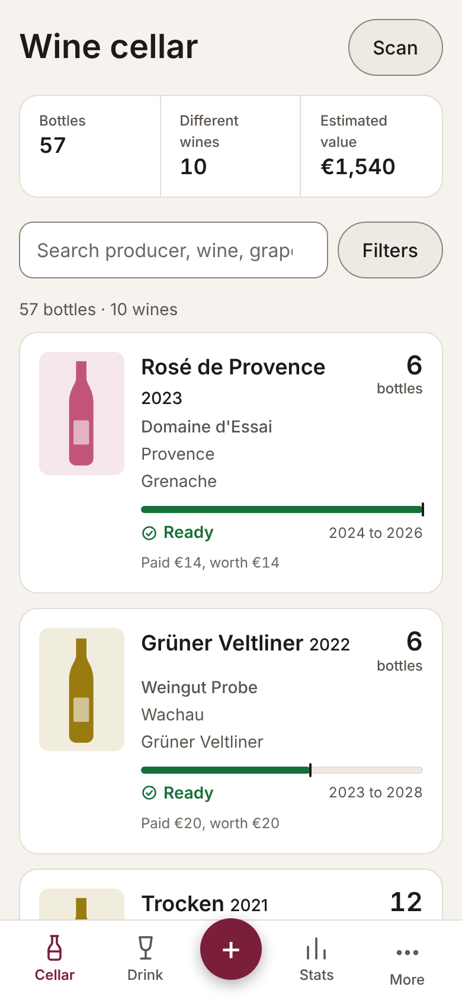
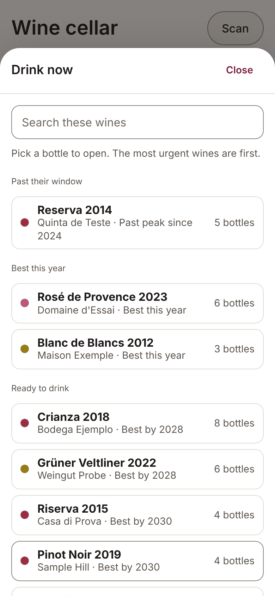
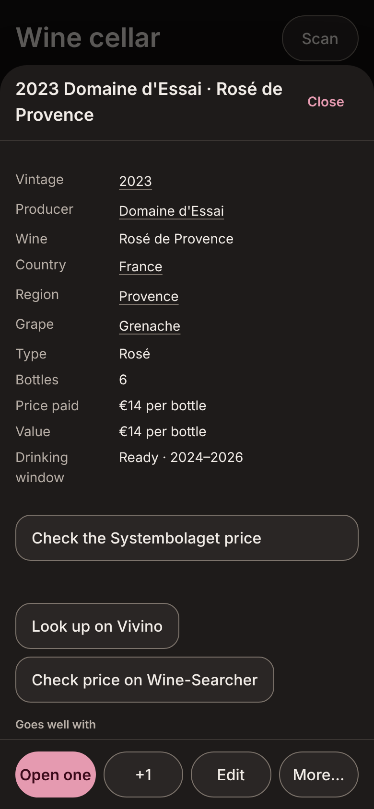
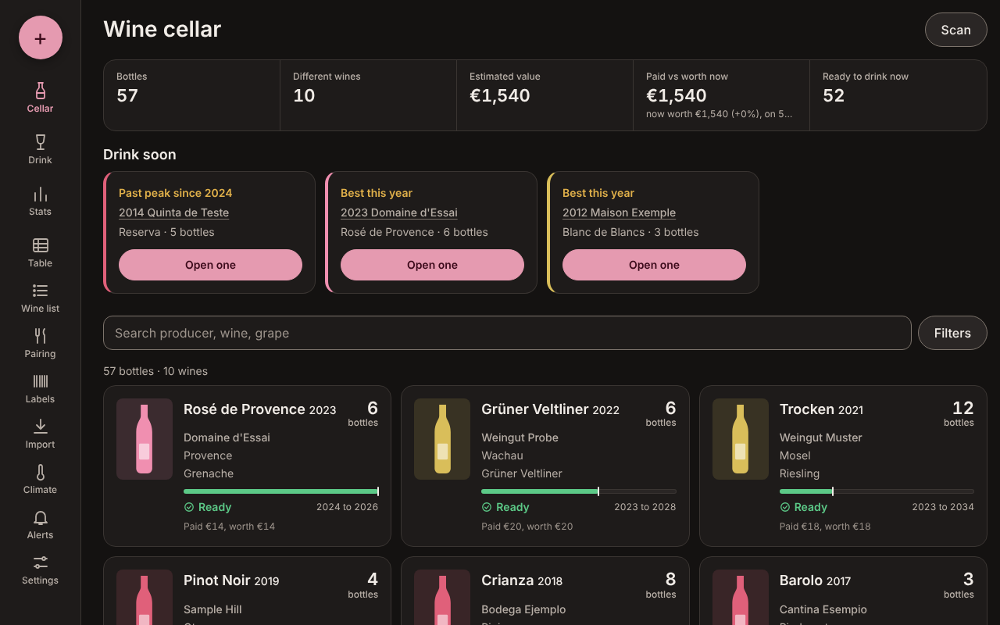
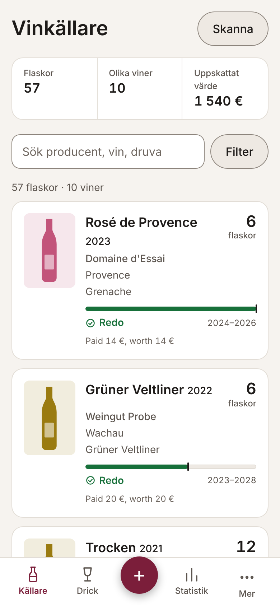

# Wine Cellar for Home Assistant

**Your cellar, your data.** This project exists because I did not want to hand my wine collection to someone else's service. Wine Cellar keeps everything on your own Home Assistant, in one file you can back up, export or delete whenever you like.

A wine cellar app that runs inside Home Assistant. Add, drink and move bottles, see what is ready to drink, scan barcodes and labels, get dinner pairings, watch your cellar's temperature and humidity, and get a weekly reminder about bottles to drink. No account, no cloud, no database server: your cellar is one file inside the add-on and is part of normal Home Assistant backups.

(The screenshots use made-up wines.)

## Your data stays yours
- **Nothing is stored anywhere else.** Your cellar is one database file inside the add-on, on your own Home Assistant. There is no account, no cloud service and no company holding your collection.
- **No tracking.** No analytics, no telemetry, no adverts.
- **You can always leave.** Export everything at any time as a CSV (CellarTracker's format) or a full JSON copy with pictures and history. Uninstall the add-on with its data and it is gone.
- **Any connection to the internet is optional and explained.** Out of the box the add-on only asks Open Food Facts for bottle pictures, and you can switch that off. Systembolaget prices and Gemini label reading are off until you turn them on, and Gemini uses your own key. See [what leaves your home](wine_cellar/DOCS.md).
- **Open source (Apache 2.0)**, so you can read exactly what it does.

## Features
- **Your cellar:** bottles, vintages, drinking windows, prices and values, several storage places (fridges, cellar, bar), gift and occasion tags, scores and reviews. Import and export CellarTracker CSV; full backup and restore.
- **What to drink:** a *Drink now* list, one clear status per wine (Ready, Hold, Past peak, No window), and a weekly reminder through any Home Assistant notify service.
- **Home Assistant:** cellar sensors over MQTT (bottles, ready, past peak, value) for dashboards and automations, and your own temperature and humidity sensors with alarms.
- **Adding wines:** barcode scanning (camera or a photo, also on iPhone), label photo reading (on your device, or better with your own optional Gemini key), pictures by paste, drop or zip.
- **Food and wine pairing** that works offline, a printable wine list and printable bottle barcode labels, stats and charts.
- **Made for phones and wall tablets:** light and dark mode, text size, and a menu you arrange yourself.
- **Languages:** English and Swedish, and adding another is one JSON file ([how](wine_cellar/app/lang/README.md)).

## Install

**Quickest way:** tap the button above (it opens your own Home Assistant and asks you to confirm adding the repository). Then go to step 2. Or add it by hand:

1. Add this repository (`https://github.com/niklasschwarz-sketch/ha-wine-cellar`) in Settings → Add-ons → Add-on store → ⋮ → Repositories.
2. Install **Wine Cellar**, start it and turn on "Show in sidebar".

No database setup is needed: the cellar is kept in a file inside the add-on and is part of Home Assistant backups. See [`wine_cellar/DOCS.md`](wine_cellar/DOCS.md) for the full guide.

## Quick start for testers
**What you need:** Home Assistant OS or Supervised (add-ons are not available on Container or Core installs), on a 64-bit Intel/AMD or ARM machine. About 100 MB of disk. The first install builds the add-on on your own system and downloads about 20 MB, so allow a few minutes.

**Install:** tap the "Add repository" button above (or add the repository by hand), install **Wine Cellar**, start it and turn on "Show in sidebar". Nothing needs configuring. Import a CellarTracker CSV (**More → Import / export**) or add a few wines by hand.

**Finding things:** on a phone, extra options are under **More** in the bottom bar; on a wide screen they are listed down the left side. Settings → *Customise the menu* lets you reorder, move or hide them.

**What to try:** add and drink bottles, scan or type a barcode, paste a picture, open a bottle for "Goes well with", use **More → Dinner pairing**, tag a bottle as a gift with a birthday date, print a label from **More → Bottle labels** and scan it back, turn on the weekly reminder under **More → Alerts and sensors**, and (if you have cellar temperature or humidity sensors) pick them under **More → Cellar climate**.

**What leaves your home:** the add-on looks up bottle pictures on Open Food Facts (switch off with `auto_images`), downloads Systembolaget prices if you turn that on, and, only if you add your own Gemini key, sends each label photo you take to Google to be read. Without a key, label photos are read inside your own browser. Details are in [`wine_cellar/DOCS.md`](wine_cellar/DOCS.md).

**Uninstall cleanly:** Settings → Add-ons → Wine Cellar → Uninstall, and tick the option to delete the add-on's data. That removes the add-on, its image and its database file. It created nothing else in Home Assistant: no helpers, entities or automations, and it changed no settings. Things you may still want to remove by hand: the repository entry (Add-on store → ⋮ → Repositories), the `wine_cellar` folder in `/local_apps` if you installed that way, and any Home Assistant backup you made while it was installed (backups include the add-on's data). 

**Feedback:** [open an issue](https://github.com/niklasschwarz-sketch/ha-wine-cellar/issues/new/choose) or reply in the forum thread. Say what you tried, what you expected and what happened, and include your device and the add-on's Log tab text if something failed. Please export a CSV from **Import / export** before an update, to be safe. Changes per version are in [`wine_cellar/CHANGELOG.md`](wine_cellar/CHANGELOG.md).

## Languages
The app can be shown in more than one language (Settings → On this device → Language). Adding a language is one JSON file: see [`wine_cellar/app/lang/README.md`](wine_cellar/app/lang/README.md). Translations are welcome as pull requests.

## Adding pictures in bulk
**More → Import / export → Import pictures from a zip.** The zip format is described in [`PICTURE_ZIP_FORMAT.md`](PICTURE_ZIP_FORMAT.md), so you can make your own zip from your own photos or any other source you have the right to use. The add-on itself only downloads pictures from Open Food Facts.

## Licences and credits
Wine Cellar is released under the [Apache License 2.0](LICENSE) (see also [`NOTICE`](NOTICE)). It is provided as is, without warranty, and the author is not liable for damages or data loss. Make a Home Assistant backup before installing or updating. See [`THIRD_PARTY_NOTICES.md`](THIRD_PARTY_NOTICES.md) for the open-source components, the data sources and the non-affiliation note.

## Development
There is no build step. `python3 test_api.py` starts the server on a temporary SQLite file and runs the API tests (no network needed). `python3 test_ui.py` drives the page in headless Chromium (`pip install playwright && playwright install chromium`). See [`CONTRIBUTING.md`](CONTRIBUTING.md).

## Updating
Bump `version` in `wine_cellar/config.yaml` and `VERSION` in `server.py`, add an entry to `wine_cellar/CHANGELOG.md` and push. Home Assistant shows the update after its next repository refresh.

## Help and feedback
- Bugs and ideas: [Issues](https://github.com/niklasschwarz-sketch/ha-wine-cellar/issues/new/choose)
- Security problems: see [`SECURITY.md`](SECURITY.md)
- Contributing and translations: [`CONTRIBUTING.md`](CONTRIBUTING.md)
